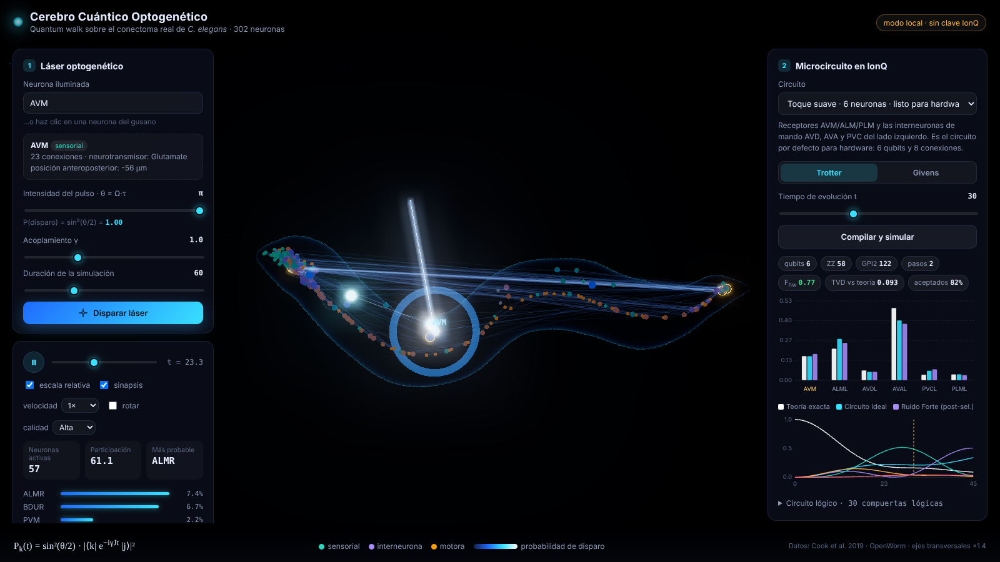

# Cerebro Cuántico Optogenético

Visualización 3D del conectoma real de *C. elegans* (302 neuronas). Un "láser optogenético" ilumina una neurona y un **quantum walk** propaga la excitación por las sinapsis reales del gusano. Un microcircuito del reflejo de toque se compila a compuertas nativas de **IonQ Forte** para correr en hardware cuántico real.


*Vista previa ilustrativa con una red sintética de 302 neuronas. El prototipo ya usa el conectoma real.*

> This effort is supported by Qollab & IonQ.

| Documento | Contenido |
| --- | --- |
| [`docs/TEORIA.md`](docs/TEORIA.md) | Física y fundamento de cada decisión del backend (modelo XY, láser como rotación de Rabi, Trotter, compilación a IonQ, errores, referencias) |
| [`docs/ARQUITECTURA.md`](docs/ARQUITECTURA.md) | Carpetas, módulos, API y flujo de datos |
| `Cerebro Cuántico Optogenético.docx` | La idea original, con diagramas |

---

## Versión para Qollab (la que se entrega)

La carpeta [`qollab/`](qollab/README.md) contiene el proyecto **JS / Qiskit** que corre en Qollab.xyz. En ella:

- Python (Pyodide) arma los circuitos con `qiskit.QuantumCircuit`;
- los circuitos se ejecutan con el `backend` que elige quien presiona *Run*: simulador del navegador, simuladores de IonQ o hardware Forte.

Los pasos para subirla y el texto de la página del proyecto están en [`qollab/README.md`](qollab/README.md). Para probarla en local:

```bash
cd qollab
python dev/servidor.py      # http://127.0.0.1:8765
```

---

## Prototipo: cómo correrlo

Requisitos: Python 3.10 o superior. El frontend no necesita instalación porque three.js ya viene incluido en `frontend/vendor/`, así que funciona sin internet.

```bash
# 1. Entorno e instalación (Windows: .venv\Scripts\activate)
python -m venv .venv
source .venv/bin/activate
pip install -r backend/requirements.txt

# 2. Arrancar (sirve la API y la interfaz)
cd backend
python run.py
# → abrir http://127.0.0.1:8000
```

### Conectar IonQ

1. Copia `backend/.env.example` como `backend/.env` y pega tu `IONQ_API_KEY` (cloud.ionq.com → API Keys).
2. Prueba sin costo en el simulador de IonQ con el modelo de ruido de Forte:

   ```bash
   cd backend
   python scripts/run_ionq_experiment.py --dry-run                 # recursos y circuito, sin enviar
   python scripts/run_ionq_experiment.py --backend simulator --noise forte-1
   ```

3. Hardware real: pon `ALLOW_QPU=true` en `.env` y ejecuta:

   ```bash
   python scripts/run_ionq_experiment.py --backend qpu.forte-1 --times 10 20 30 40 --shots 500
   ```

   Las corridas en QPU tienen costo. El script pide confirmación antes de enviar.

Los resultados quedan en `backend/data/results/jobs/` y la interfaz los muestra junto a la teoría.

### Tests

```bash
cd backend
python -m unittest discover -s tests      # 28 pruebas: física, compilación, Trotter, ruido, flujo IonQ, modelo 3D
python scripts/resource_report.py         # presupuesto de compuertas para IonQ Forte
```

### Qué hace hoy el prototipo



- **Red completa (302 neuronas):** quantum walk exacto. Haz clic en cualquier neurona para dispararle el láser y ver la propagación en 3D.
- **Microcircuito de toque (6, 7, 10 o 14 neuronas):**
  - Teoría exacta, circuito de Trotter y simulación local con ruido tipo Forte, con post-selección.
  - Circuito compilado a `gpi`/`gpi2`/`zz` nativas, verificado matriz por matriz.
  - Envío a IonQ desde la interfaz o por script.
- **Exportación:** JSON listo para la API de IonQ y OpenQASM 2.0 (para Qiskit o Braket).

### Si la app se ve lenta

En el panel izquierdo hay un selector de **calidad**:

- **Auto** (por defecto) baja la calidad sola si la animación cae bajo 28 cuadros por segundo.
- **Alta** usa resplandor a resolución completa.
- **Media** usa resplandor a media resolución.
- **Baja** quita el resplandor y reduce la resolución; está pensada para notebooks con gráficos integrados.

La escena sólo se dibuja cuando algo cambia, así que en reposo casi no usa la tarjeta gráfica. La casilla **rotar** activa el giro automático, que viene apagado para ahorrar recursos.

### Video cinematográfico en Blender

```
blender\renderizar.bat eevee media AVM
```

Genera `blender/render/cerebro_cuantico.mp4` con los mismos datos y la misma física que la app. Requiere Blender 4.2 o superior; los detalles están en [`blender/README.md`](blender/README.md). El cuerpo 3D de la app (`frontend/assets/gusano.glb`) se puede editar en Blender y volver a exportar ([`docs/MODELO_3D.md`](docs/MODELO_3D.md)).

### Estructura del repositorio

```
├── backend/
│   ├── cerebro/              # paquete principal
│   │   ├── connectome.py     # datos reales → matriz J hermítica
│   │   ├── hamiltonian.py    # modelo XY / quantum walk exacto
│   │   ├── circuits/         # IR, simulador, Trotter/Givens, compilación a IonQ
│   │   ├── ionq/             # cliente REST v0.4 + registro de experimentos
│   │   ├── analysis.py       # post-selección y métricas
│   │   ├── anatomy.py        # malla anatómica del gusano (cuerpo + faringe)
│   │   ├── gltf.py           # escritor .glb sin dependencias
│   │   ├── microcircuits.py  # circuitos de toque predefinidos
│   │   ├── pipeline.py       # servicios que usa la API
│   │   └── api/              # servidor HTTP (Starlette)
│   ├── data/                 # conectoma (Cook 2019) y posiciones (OpenWorm)
│   ├── scripts/              # experimento IonQ, recursos, modelo 3D, exportar a Blender
│   ├── tests/                # pruebas + IonQ simulado
│   └── run.py
├── frontend/                 # interfaz three.js (sin build) + assets/gusano.glb
├── blender/                  # escena cinematográfica (script bpy) y render del video
├── qollab/                   # proyecto JS / Qiskit para Qollab.xyz (lo que se entrega)
└── docs/                     # TEORIA.md, ARQUITECTURA.md, MODELO_3D.md
```

---

## Metodología de trabajo: 4 personas, viernes a domingo

> El prototipo inicial ya cubre el esqueleto de cada rol. El fin de semana se usa para entender, validar en IonQ, pulir y presentar.

### Principios

1. **Primero el MVP.** El MVP es el quantum walk sobre el conectoma, con un gusano 3D y clic para iluminar. Nada se agrega encima hasta que eso funcione de punta a punta.
2. **Integrar temprano y seguido.** Cada pieza se conecta con las demás desde el viernes.
3. **Siempre hay algo que mostrar.** Al cierre de cada día, `main` tiene una demo que funciona.
4. **Timeboxes estrictos.** Si algo se traba más de 45 minutos, se pide ayuda o se cambia de enfoque.

### Roles

Cada rol tiene dueño, pero todos pueden ayudar en los demás.

| Persona | Rol | Es dueña de | Punto de partida en el prototipo |
| --- | --- | --- | --- |
| **P1** | Física / quantum walk | Conectoma, matriz J, P_k(t) = sin²(θ/2)\|⟨k\|e^{-iγJt}\|j⟩\|² | `connectome.py`, `hamiltonian.py`, `docs/TEORIA.md` §2–§5 |
| **P2** | Circuito y hardware IonQ | Microcircuito de toque, Trotter/Givens, compilación nativa, corridas en IonQ | `circuits/`, `ionq/`, `scripts/run_ionq_experiment.py` |
| **P3** | Frontend 3D | Gusano, clic-láser, animación, panel de IonQ | `frontend/js/scene.js`, `main.js`, `charts.js` |
| **P4** | Integración y presentación | API, repositorio, narrativa, slides y video de respaldo | `api/app.py`, `pipeline.py`, README |

P4 también hace de *facilitador*: lleva el tiempo, corre los check-ins y decide cuándo se congela el código.

### Contrato entre piezas (ya implementado)

```
GET  /api/connectome                 -> { neurons: [{name, x, y, z, type, degree}], edges: [[i, j, J_ij]] }
POST /api/walk                       <- { source, theta, gamma, t_max, frames }
                                     -> { times: [...], prob: [[302 valores], ...], participation: [...] }
POST /api/microcircuit/simulate      <- { preset, sources, theta, t, mode: "trotter"|"givens" }
                                     -> { exact, circuit_ideal, noisy_local, resources, circuit: {ionq_native, ...} }
POST /api/ionq/submit                <- lo anterior + { backend, noise_model, shots }
GET  /api/ionq/jobs/{id}             -> estado y análisis (post-selección, TVD)
```

---

## Plan por día

### Viernes: entender el prototipo y validarlo en IonQ

| Bloque | Qué se hace | Quién |
| --- | --- | --- |
| Kickoff (1 h) | Correr el prototipo en cada computador, leer juntos `docs/TEORIA.md` §1 y §3–§4, confirmar roles | Todos |
| Bloque 1 (3 h) | P1: revisar la construcción de J y probar otros pesos (`binary`, `count`) · P2: `--dry-run` y primera corrida en el simulador de IonQ con ruido `forte-1` · P3: recorrer la interfaz y anotar mejoras visuales · P4: tablero de tareas y guion preliminar | Cada uno en lo suyo |
| Check-in (15 min) | ¿Qué funciona? ¿Qué bloquea? | Todos |
| Bloque 2 (3 h) | P1: elegir el tiempo t y la neurona fuente que mejor cuentan la historia · P2: enviar el experimento a la QPU Forte (la cola puede tardar) · P3: pulir la animación del láser y la cámara · P4: integrar y ayudar donde haya bloqueo | Cada uno en lo suyo |
| Cierre (30 min) | **Hito 1:** resultados del simulador de IonQ visibles en la interfaz junto a la teoría | Todos |

### Sábado: MVP sólido y el hardware real

| Bloque | Qué se hace | Quién |
| --- | --- | --- |
| Stand-up (15 min) | Revisar el hito 1 y priorizar el día | Todos |
| Bloque 1 (3,5 h) | P1: ajustar γ y t para que la propagación se vea bien, y mapear θ → estado inicial · P3: glow, colores, cámara, slider de intensidad · P2: resultados de IonQ en JSON, conectados a la API · P4: guion de la demo | Cada uno en lo suyo |
| Check-in (15 min) | Probar la demo completa una vez | Todos |
| Bloque 2 (3,5 h) | P3 + P2: animar las ráfagas de spikes del microcircuito sobre el gusano · P1: sección de física para las slides · P4: slides y grabar un video de respaldo preliminar | Pares |
| Cierre (30 min) | **Hito 2:** demo completa de punta a punta. **Congelar funcionalidades:** desde aquí no se agrega nada nuevo | Todos |

### Domingo: pulir, ensayar y entregar

| Bloque | Qué se hace | Quién |
| --- | --- | --- |
| Stand-up (15 min) | Lista de bugs y detalles visuales, en orden de prioridad | Todos |
| Bloque 1 (3 h) | Solo corregir bugs y pulir lo visual. Probar en el computador que se usará para presentar | P1, P2, P3 |
| Bloque 1 (3 h) | Cerrar slides, grabar el video final de respaldo, README del repo | P4 |
| Ensayo (1 h) | Al menos 2 ensayos completos con cronómetro. Todos deben poder explicar la analogía luz → qubit → neurona | Todos |
| Entrega | Subir el repo, el video y las slides | P4 |

> Si la entrega es el domingo temprano, el bloque de pulido se acorta y el ensayo pasa a ser lo primero del día.

---

## Rituales y reglas del equipo

- **Check-ins cortos (15 min)** tras cada bloque: qué hice, qué sigue y qué me bloquea.
- **Git:** una rama por persona (`fisica`, `circuito`, `frontend`, `backend`), merge a `main` al menos dos veces al día y siempre antes del cierre. Nada roto en `main`.
- **Tablero de tareas:** tres columnas (Por hacer, En curso, Listo) en el canal del grupo o en un tablero compartido. Cada tarea tiene un dueño.
- **Plan B siempre listo:** resultados de IonQ precalculados, un video de la demo y la escena capaz de funcionar sin backend con datos guardados.
- **Descansos:** comer lejos del computador. Un equipo cansado introduce bugs el domingo.

## Definición de "listo"

Una tarea está lista cuando:

1. funciona integrada en `main`, no solo en la rama propia,
2. otra persona del equipo la probó, y
3. se puede explicar en una frase durante la presentación.

## Lista de extras (solo si sobra tiempo después del hito 2)

- [ ] Sonido para cada spike
- [ ] Mostrar la ecuación en pantalla mientras se anima
- [ ] Segundo organismo (larva de *Drosophila*)

---

## Trabajo previo y créditos (divulgación para la hackathon)

Las bases de la Qollab × IonQ Quantum Hackathon permiten partir de código existente si se declara, y el jurado evalúa lo que se agrega durante la ventana de construcción (9 oct. 19:00 ET – 11 oct. 19:00 ET).

**Construido antes de la ventana** (7–9 oct. 2026, con asistencia de IA, Claude de Anthropic). El último commit previo queda marcado con la etiqueta `pre-hackathon`:

- Backend en Python: conectoma → hamiltoniano XY, quantum walk exacto, circuitos Trotter/Givens, compilación a nativas de IonQ, simulador con ruido, cliente REST de IonQ y API.
- Frontend 3D en three.js, modelo anatómico `.glb`, escena de Blender y documentación (`docs/`).

**Agregado durante la ventana:** se completará al cierre (ver historial de commits posteriores a `pre-hackathon`).

**Bibliotecas y datos de terceros:**

- [three.js](https://github.com/mrdoob/three.js) r170 (MIT), incluido en `frontend/vendor/three/`.
- Conectoma de Cook et al., *Nature* 2019, y posiciones de [OpenWorm](https://github.com/openworm) (MIT).
- numpy, scipy, starlette, uvicorn, pydantic y requests.

**Licencia:** MIT (ver `LICENSE`).
