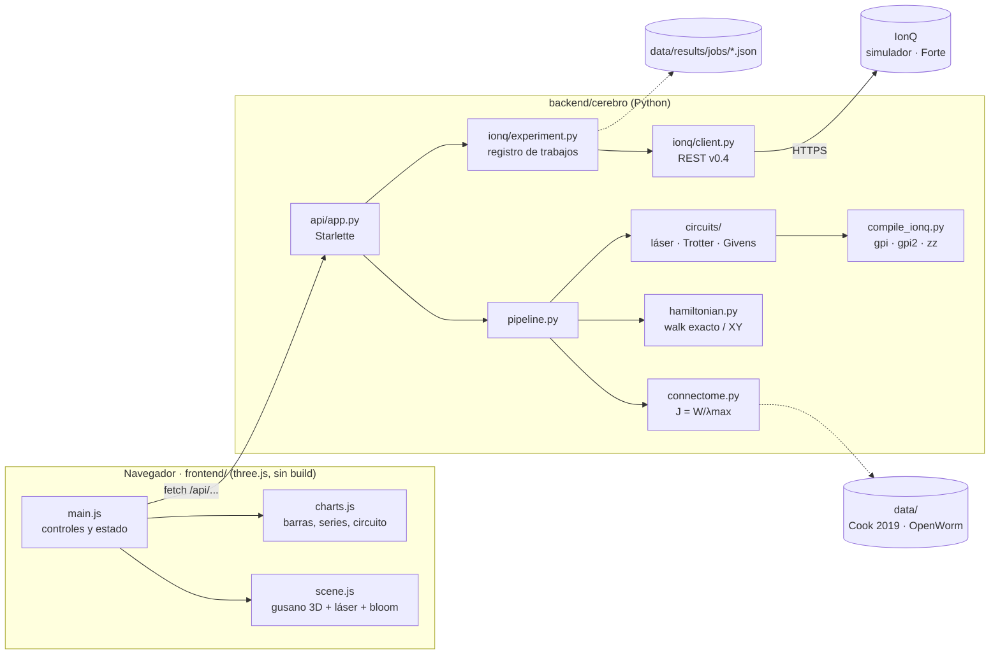

# Arquitectura del prototipo

Un solo proceso de Python (`backend/run.py`) sirve la API JSON y los archivos estáticos del frontend. No hay base de datos: el conectoma se carga desde `backend/data/` y los experimentos de IonQ se guardan como JSON.

## Flujo 1: láser en la red completa

1. Clic en una neurona, o botón **Disparar láser**, envía `POST /api/walk {source, theta, gamma, t_max}`.
2. `pipeline.full_network_walk` usa la diagonalización cacheada de J y devuelve $P_k(t)$ para 302 neuronas × 160 fotogramas.
3. `scene.js` anima el haz del láser y luego interpola los fotogramas a 60 fps: color y tamaño por neurona, brillo de sinapsis por $\sqrt{P_iP_j}$.

## Flujo 2: microcircuito → IonQ

1. **Compilar y simular** envía `POST /api/microcircuit/simulate`.
2. `pipeline.simulate_microcircuit` hace lo siguiente:
   - restringe J a las neuronas del preset;
   - elige los pasos de Trotter óptimos (`autotune_steps`);
   - construye el circuito lógico (`RX` + `hop`) y lo compila a nativas de Forte y a QIS;
   - simula la teoría exacta, el circuito ideal y el ruido Forte local, este último con post-selección.
3. **Enviar a IonQ** llama a `POST /api/ionq/submit`, que crea el trabajo con `ionq/client.py` y lo guarda en `data/results/jobs/<id>.json`.
4. La interfaz consulta `GET /api/ionq/jobs/{id}` cada 5 s. Al completarse, descarga las probabilidades, aplica post-selección, calcula la TVD y agrega la serie "IonQ" al gráfico de barras.

## Convenciones

| Tema | Convención |
| --- | --- |
| Orden de qubits | qubit q = bit q del índice (q0 = menos significativo); el qubit i corresponde a la neurona i de la lista del microcircuito |
| Fases nativas IonQ | en vueltas (1 = 2π); ángulos QIS en radianes |
| Tiempo | unidades de 1/γ con ‖J‖ = 1 |
| Cadenas de bits en `counts` del simulador local | carácter i = neurona i (legible de izquierda a derecha) |
| Seguridad | `IONQ_API_KEY` sólo en `backend/.env` (ignorado por git); la QPU queda bloqueada salvo `ALLOW_QPU=true` |

## Rendimiento

| Capa | Técnica |
| --- | --- |
| API | Caché LRU de respuestas (mismo pedido → respuesta instantánea), compresión gzip y precálculo al arrancar |
| Simulación | Kernels `einsum` sin copias, matrices de compuertas cacheadas, estimador de ruido estratificado (unas 7 veces más rápido) |
| 3D | Render bajo demanda, calidad auto/alta/media/baja, bloom a media resolución, selección en espacio de pantalla, tablas de color precalculadas |
| Interfaz | Paneles de texto actualizados unas 8 veces por segundo (la escena va a la tasa de refresco) |

## Modelo 3D y Blender

`frontend/assets/gusano.glb` lo genera `scripts/generar_modelo_3d.py` a partir de `anatomy.py`. Si falta, la app usa un cuerpo aproximado. `blender/animar_gusano.py` construye la misma escena para renderizar video. Las convenciones de coordenadas están en `docs/MODELO_3D.md`.

## Dependencias

- **Backend:** numpy, scipy, starlette, uvicorn, pydantic y requests. Se eligió Starlette en vez de FastAPI para tener menos dependencias; los handlers están en `api/app.py` y la validación en `api/schemas.py`.
- **Frontend:** three.js r170 en `frontend/vendor/three/`, con licencia MIT incluida. Funciona sin conexión a internet.

## Cómo extender

| Quiero… | Dónde |
| --- | --- |
| Agregar un microcircuito | `cerebro/microcircuits.py` (lista `MICROCIRCUITS`) |
| Cambiar la ponderación de sinapsis | `connectome.build_connectome(weighting=…)` |
| Usar Aria (MS parcial) en vez de Forte | `compile_native(circ, target="aria")` |
| Exportar a Qiskit | `to_openqasm2(lower_to_qis(circ))` y luego `QuantumCircuit.from_qasm_str(...)` |
| Otro modelo de ruido local | `circuits/simulator.noisy_probabilities` |
| Nuevos controles en la interfaz | `frontend/index.html` + `js/main.js` (función `bindUI`) |
