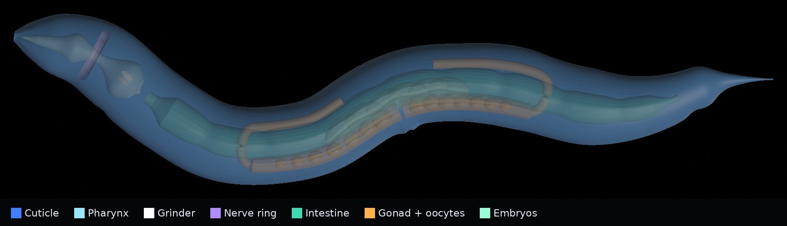
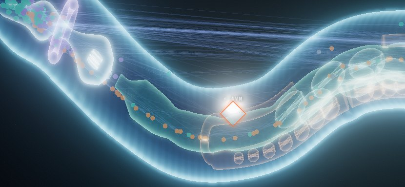
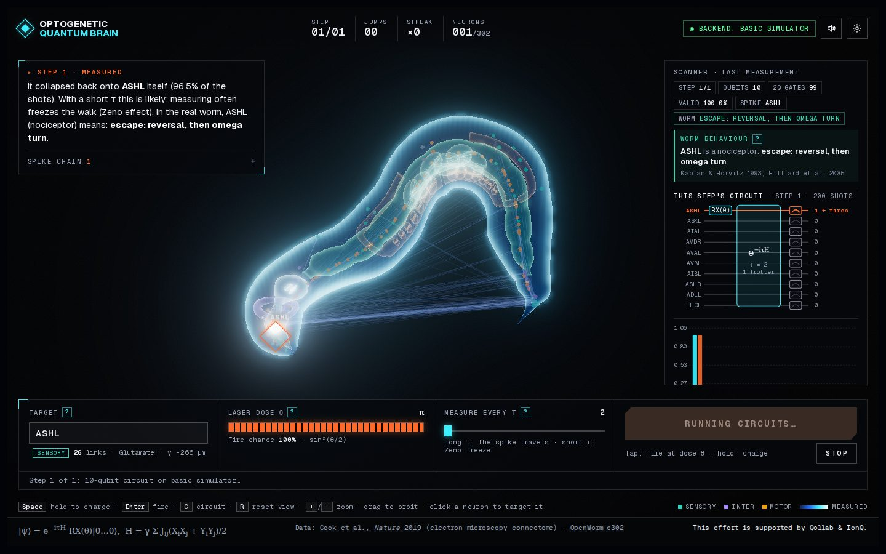

# The anatomical worm and how it moves

This feature replaces the old 3D body (a plain tube with a rough pharynx) with an anatomically detailed adult
hermaphrodite built in Blender. It also replaces the motion system, so the body and every organ inside it bend together
the way a real worm does. Coordinate frames and the regeneration command, in Spanish, are in
[3d-model.md](3d-model.md). The neuron → behaviour table is in [behaviour.md](behaviour.md).

## What you see

The worm is an adult hermaphrodite, the sex of the Cook 2019 connectome. Proportions are stylised from WormAtlas /
WormBook (Altun & Hall, *Hermaphrodite anatomy*).

| Part | What it shows |
| --- | --- |
| Cuticle (`Cuerpo`) | Six lips around the mouth, lateral alae (thin ridges along both sides), the vulva at mid-body (a ventral slit with raised lips), the anus, the excretory pore beside the terminal bulb, and the post-anal tail tapering to a whip. Cuticle rings are drawn by the shader. |
| Pharynx (`Faringe`, `Faringe_grinder`) | Buccal cavity → procorpus → metacorpus (middle bulb) → isthmus → terminal bulb, with the three-lobed grinder inside. It pulses during the "pumping" behaviour. |
| Nerve ring (`Anillo`) | A ring around the isthmus, where most head synapses are, in the violet of the interneurons. |
| Intestine (`Intestino`) | 9 rings of cells (int1–int9, 20 cells) from the terminal bulb to the anus, with the gentle twist of the real intestine. |
| Gonad (`Gonada`) | Two U-shaped arms. Each runs ventrally away from the vulva, turns dorsally and comes back, with oocytes that grow toward the spermatheca. |
| Eggs (`Huevos`) | Six embryos (about 45 × 27 µm) waiting in the uterus beside the vulva. The egg laid by the "egg laying" behaviour leaves from there. |





Everything is built from the same midline as the cloud of 302 neuron cell bodies, so **all 302 somas are inside the
body**. The previous body contained 301.

## How it moves: curvature, like real muscle

- **Before:** the swim and behaviours shifted each point up or down depending on its position along the body (a shear).
  - Cross-sections never turned, so the body thinned on steep slopes and internal organs would slide out of the cuticle.
  - That forced the swim to stay tiny, about 3 % of body length.
- **Now:** every motion is a **curvature profile** κ(s) along the body (s = 0 head, s = 1 tail), which is what muscle
  contraction produces:

  | Motion | Curvature |
  | --- | --- |
  | Crawling wave | κ = A·sin(2πs/λ − φ), λ = 0.65 body lengths. φ grows for forward (wave head → tail) and shrinks for reversal. Idle κ·L = 2.2; reversal about 6.6 (about 40° of body angle, a realistic crawl) |
  | Local bend (motor neuron) | A Gaussian bump at the neuron's position, dorsal or ventral (about 0.75 rad of turn) |
  | Relaxation (GABA neuron) | The wave's curvature drops around the neuron |
  | Head swing | Oscillating curvature in the front 22 % |
  | Omega turn | Uniform ventral curvature, about 290° in total, which curls the body into a loop |
  | Egg laying | A small ventral bend at the vulva |

- `frontend/js/escena.js` integrates the midline from κ with the **body length held constant**, anchored at mid-body
  so the worm doesn't drift. Each cross-section **turns rigidly** with its tangent.
- The result is a 64-sample table, uploaded as a small texture (`uCurva`) and read by every material, so the body, the
  organs, the neurons, the synapses and the effects all bend with one function.
- `WormScene.deform()` reads the same table on the CPU, so picking a neuron, its label and the camera flights always
  match what is drawn.
- The texture is only re-uploaded on frames where something moves.



## Files

| File | Role |
| --- | --- |
| `tools/blender/modelo_gusano.py` | Builds the whole model in Blender (headless), exports `backend/data/gusano.glb`, prints how many somas are inside, and can render preview images (`--preview`) and save a `.blend` (`--blend`) |
| `backend/data/gusano.glb` | The model, about 604 KB: no normals, 16-bit indices. glTF extras on `Cuerpo`: `largo_um`, `radio_max_um`, `vulva_um`, `ano_um` |
| `frontend/js/escena.js` | `ORGANOS` maps meshes to roles by name. `MATERIAL_ORGANO` gives each organ its fluorescence-microscope look. The curvature kinematics lives in `_writeMotion`, `_integrarCurva`, `_subirCurva` and `deform`. |

An old `.glb` with only body and pharynx still loads: the page builds the intestine itself. If the file is missing, a
procedural body is used, as before.

## Regenerate the model

From WSL, with Blender 5.2 installed on Windows:

```bash
B="/mnt/c/Program Files/Blender Foundation/Blender 5.2/blender.exe"
"$B" --background --factory-startup --python "$(wslpath -w tools/blender/modelo_gusano.py)" -- \
  --neurons "$(wslpath -w backend/data/neurons.json)" --out "$(wslpath -w backend/data/gusano.glb)" \
  --preview "$(wslpath -w /tmp/vistas)"
python tools/optimize_glb.py
```

To add an organ:
1. Build its mesh in the script and give it a name.
2. Add the name to `ORGANOS` and a look to `MATERIAL_ORGANO` in `escena.js`.

## How it was verified

| Check | Result |
| --- | --- |
| Body length at the peak of every behaviour | Exactly constant (1.0000 × rest) |
| Each soma's distance to the midline, rest vs. peak | Worst change 0.05 scene units, a sampling effect on one soma |
| End of every behaviour | Exactly back at rest (identity table) |
| Somas inside the body (Blender script) | 302 / 302 |
| Old `.glb` (body + pharynx only) | Loads, with the JS intestine |
| `python -m unittest discover -s tests/backend` | OK |
| `tests/e2e/smoke_test.py` (desktop, IonQ, hardware, behaviours, reduced motion, phone) | OK |
| `tools/build_qollab.py` | 23 files, 1.13 MB, within Qollab's limits |

## Try it

Run `python tools/dev_server.py`, open http://127.0.0.1:8765, then do any of the following:

- **Watch the worm at rest.** Look for the pharynx bulbs, the violet nerve ring, the intestine rings, the amber gonad
  arms and the eggs at mid-body.
- **Fire at AVA or AVB.** The worm crawls backward or forward with a deep wave, and every organ bends with it.
- **Fire at RIVL** (a short τ helps the spike stay there). The worm curls into an omega loop, and the camera pans down
  to frame it.
- **Fire at MCL.** The camera glides to the pharynx while it pumps.
- **Fire at HSNL.** The camera glides to the vulva and an egg is laid next to the waiting embryos.

## Trade-offs

- The body file grew from 316 KB to 604 KB, which adds to the first page load because it travels as base64 through
  Pyodide.
- Anatomy proportions are stylised, not measured.
- Local motor-neuron bends turn the rest of the body, as a real one-sided contraction would. The bend is placed at the
  cell body's position.
